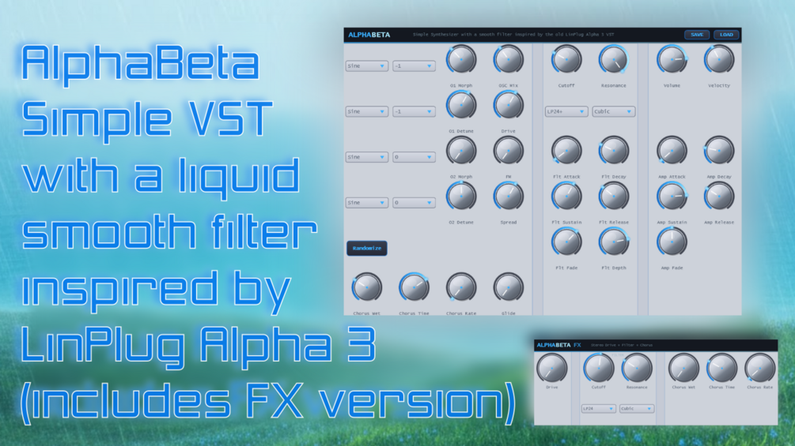

# AlphaBetaFX

**Latest version:** 3.2.1 — download builds from the [Releases](../../../../releases) page.

AlphaBeta is a synthesizer modelled after the free, but discontinued Linplug Alpha 3 synthesizer. 
AlphaBeta has, like the original, a characteristic, liquid smooth sweeping filter sound character which together with the chorus washes out the signal really well.
Since the Filter is the unique feature, I also added this separate AlphaBetaFX Effect VST that you can put in your FX chain. It also has an envelope control (ADSR, Amount and Retrigger). As it is an FX plugin, it can not easily / reliably retrigger on each midi note, but the filter ADSR will retrigger after each short amount of silence. Like the synth, it has a native mode (an earlier simpler implementation) and a original mode (a close model of the original VST modelled by ear and Claude's methods, the AI by Anthropic).

Thanks for checking it out!
