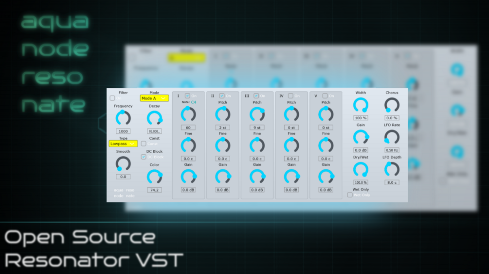

# Resonate

**Latest version:** 4.0 — download builds from the [Releases](../../../../releases) page.

Resonate is a 7 voice resonator. It is closely modelled after a famous resonator available in a certain DAW. Resonate recreates most of its controls and functionalities with four different engines that all have a slightly different character. Some are much closer to the original, others have their own character. The code for Resonate was completely done from scratch (in the JUCE framework) and with the help of Claude AI. Depending on the mode you set, its note range is much broader than the original, supports individual resonator panning and MIDI controllable pitch of the resonators.

Resonate includes a per-Resonator Decay and Color logic and can add exponential decay / DC offset to sound closer to the original. It also includes a subtle chorus and a square resonator mode (Mode B in the selector), again depending on the model you choose.

Next to the usual filter, decay, stereo and dry/wet controls, you have the seven resonators. With Resonator 1 you set the main pitch, while the others are tuned around it in semitones. A cyan text display will show you which note is active.

As mentioned, the source code is completely made from scratch using the help of Claude AI and written in JUCE / C++. I provide the .vst3 and a standalone .exe for Windows, but you can compile the source code yourself for Mac and Linux as far as I know, as JUCE supports these platforms.

## Changing modes
The input moves to the new engine immediately, with a 5 ms ramp so cutting in mid-waveform can't click. The previous engine gets no more input and rings out naturally until a fade out after -70dB is added.

**Engines** (yellow *Engine* dropdown under the logo):

| Engine | What it is | File |
|---|---|---|
| Modelled (default) | measured model, v4 (allpass read, brightness fix) | `ResonatorCore.h`, `ResFitTables.h` |
| Dark | v3.0 (Lagrange read, slightly darker) | `ResonatorCoreDark.h`, `ResFitTablesDark.h` |
| Native | The original v2 DSP | `NativeEngine.h` |
| Crisp | v1 DSP (chorus/LFO, membrane, DC Center, Exp Decay, Smooth, 2x OS) | `CrispEngine.h` |

## Version History

- **1.0** — Initial release.
- **1.1** — Adds a subtle chorus and a working "square" resonator mode (Mode B in the selector).
- **1.2** — Adds a per-Resonator Decay and Color logic and adds exponential decay / DC offset to sound closer to the original.
- **2.0** — Added per-Resonator Panning, GUI resizability, MIDI playability and performance bugfixes. If you saved presets in a previous version, they might sound wrong in version 2.0, as especially the decay knob skew changed. 
- **2.1** — Improved GUI layout and resize ability, added two more resonators. 
- **3.0** - Simplified the model.
- **4.0** Re-added the model from version 2.1 as well as two new models sounding much closer than the original.

Thanks for downloading and have fun with it!
