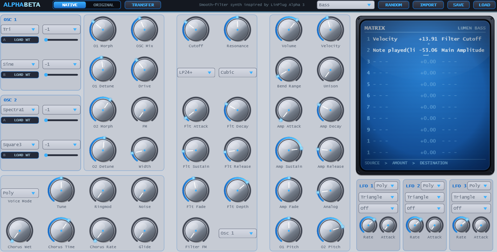

# AlphaBetaSynth

**Latest version:** 3.1.4 - download builds from the [Releases](../../../../releases) page.
In the Downloads you will find AlphaBeta.vst3, an older / simpler version, and AlphaBetaSynth.vst3, the "full" version.

## About AlphaBeta

AlphaBeta is a classic 2000s-style synthesizer modelled after the free, but discontinued Linplug Alpha 3 synthesizer. It has the same overall functions as the original, but two different voice engines: One native engine that is completely done from scratch and only loosely shares the original's character, and an "original" engine that sounds almost exactly like the original without using any of the original's code - simply by measuring filter paths and everything else by ear and Claude's analyses. 

It can load original presets and can also export patches to the original fxp format, but in general the .abpreset xml-files are recommended. Presets will sound very close to the original in the original engine, but only loosely like the original. 

AlphaBeta has, like the original, a characteristic, liquid smooth sweeping filter sound character which together with the chorus washes out the signal really nice.

The smooth Filter is the unique feature of AlphaBeta. I also added a separate AlphaBetaFX Effect VST that you can put in your FX chain. It also has an envelope control (ADSR, Amount and Retrigger). As it is an FX plugin, it can not easily / reliably retrigger on each midi note, but the filter ADSR will retrigger after each short amount of silence.

AlphaBeta has a CRT-like screen with a modulation matrix that lets you easily link LFOs to many other parameters as well as a randomize button to let you quickly get new ideas from the synth.

Per Oscillator, you have two voices you can morph between. Other controls are pretty standard, but the most important ones are the fade and depth knobs: Fade sets the depth at which the filters cutoff frequency moves from the sustain value to either the cutoff parameters value when the dial is turned completely counter-clockwise or envelope depth when the dial is turned completely clockwise. The depth dial is used to set the degree to which the filter's envelope effects the signal. -100% means that the envelope has full negative effect on the filter. A middle position means that it has no effect on the filter. 100% (i.e. turning the dial completely clockwise) means that the filter is modulated by the envelope's full range. FM from Oscillator 2 to Oscillator 1 is active when it has values higher than 0.

I provided a few simple presets in the download as well, these are generally made for the older versions of the synth though - both versions are in the download.

Thanks for checking it out!

## Features and Extras

**Oscillators.** 30 waveform names (26 re-imagined from the original), -2..+2 octave ranges, two oscillators with two voices each plus noise, ring modulation, detune, filter with its own envelope and drive, amp envelope with fade, velocity, spread (as Unison), 11-slot modulation matrix, 3 LFOs with tempo sync, glide with mono/legato modes, chorus, 32 voices, analogness, master tune. Oscillator symmetry (via the matrix), noise mix, ring modulation on OSC 2, audio-rate filter FM with source select, pitch-bend range. Further additions are 2-op FM, oscillator pitch knobs, per-oscillator detune, resonance curve, stereo Width, selectable filter-FM source and user wavetables.

**Wavetables.** Every wave slot (wave A and wave B of both oscillators, four in total) has its own table strip and position slider under its wave chooser. Click *LOAD WT* to import a .wav / .aif / .flac file (right-click to clear or to choose a frame size); that slot's waveform switches to *Table*. Each slot is either a built-in wave or its own wavetable, and the oscillator's morph knob blends A and B as always. Frames are resampled to 2048 samples internally, up to 256 frames per table. Tables work with morph, symmetry, FM, ringmod and unison like any other waveform. Wave A and wave B of each oscillator have separate wavetables and position sliders, so an oscillator can morph between two different tables, or between a table and a built-in wave.

**LFOs.** Sine, Triangle, Sawtooth, Square, Noise and SampleHold; rate 0.01-32 Hz or tempo sync (dotted and triplet values); attack; Mono (shared, locks to the song position when synced) or Poly (restarts per note).

**Modulation matrix.** AlphaBeta has a Modulation Matrix with 11 slots on a blue CRT-inspired screen, like the original. Sources and destinations follow the original: note (log/lin), velocity, aftertouch, pitch wheel, mod wheel, breath, foot, expression, CC16-19, both envelopes, three LFOs and Constant, routed to oscillator amplitude/pitch/symmetry, ringmod, noise, cutoff, cutoff FM, resonance, main amplitude/pitch, matrix depth 1-3 and LFO 1/2 speed. Click a source or destination to choose it, drag the amount (Shift = fine), mouse wheel nudges, click twice to set the amount to 0 and back, right-click clears a slot. Pitch amounts are shown as semitones:cents. Scaling constants are 100% pitch = 24 semitones, 100% cutoff = 5 octaves and 100% LFO speed = 4 octaves.

**Preset Randomizer.** Pick a kind of sound in the menu next to RANDOM, then press RANDOM for a new patch of that kind. Each random preset character is a profile of waveform pools, register, oscillator interval, filter type and window, both envelopes, chorus, unison, glide and voice mode, plus behaviour flags that wire up the LFOs and the matrix (tempo-synced wobble, delayed vibrato, PWM shimmer, sample & hold steps, key tracking, pitch drops and rises, the Alpha factory-bass key scaling).

**Preset Mutation.** Wiggles all the knobs that do not change pitch too much (pitch only really can be changed in the modulation matrix screen) slightly. The more you press the mutate button, the more the preset will differ over time.

## Filter

The smooth Filter is the unique feature of AlphaBeta, providing the characteristic liquid-smooth sweeping filter sound especially in the LP24+ setting. Together with the chorus it can wash out the signal really nicely. The filter has its own envelope and drive, with filter cutoff, resonance, fade and depth controls. Audio-rate filter FM is available with a selectable source. The filter's **Fade** sets the depth at which the filter's cutoff frequency moves from the sustain value to either the cutoff parameter's value when the dial is turned completely counter-clockwise or the envelope depth when the dial is turned completely clockwise. The **Depth** dial sets the degree to which the filter's envelope affects the signal. **-100%** means that the envelope has full negative effect on the filter. **0%** means that the envelope has no effect on the filter. **100%** means that the filter is modulated by the envelope's full range. FM from Oscillator 2 to Oscillator 1 is active when it has values higher than 0.

## Dual Engine: NATIVE | ORIGINAL

The switch in the title bar selects the sound engine:

* **NATIVE** – the AlphaBeta engine described as above.
* **ORIGINAL** – a model of the LinPlug FreeAlpha 3.3 engine, built by measuring the original plugin (oscillator wavetables, filters, drive, envelopes, glide, chorus, matrix scaling). The panel switches to the original's controls: two oscillators with wave A/B, range and mix, balance, detune, spread, drive, LP12/LP24/LP24+/BP12/HP12 filter with env depth, ADSR+fade envelopes, glide (Off/Held/On/Bend), voices, chorus, one LFO and the original 11-row matrix on the CRT. While you turn a knob, its value is shown in the original's units.

**Please Note:** Even though LinPlug does not exist as a company anymore, the copyright of the original device still belongs to them. This is why I modelled the original engine only after the free version, as the full version can't be obtained legally anymore. The free version of LinPlug Alpha 3 only misses more LFOs and FM, these are included in the native engine though.

Each engine keeps its own patch, so you can flip the switch to compare. In ORIGINAL mode:

* **PRESETS** (bottom of the panel): the bundled Alpha 3 presets, grouped as Bass, Keys, Lead, Pad, Texture, FX and Drum. Use the arrows to step through them. `PRESETS.md` lists where each one came from.
* **IMPORT** loads Alpha 3 / FreeAlpha `.fxp` presets (or the first program of an `.fxb`) exactly into the ORIGINAL engine and, as before, an approximate translation into the NATIVE engine.
* **RANDOM** has one menu for both engines. Each engine uses its own generator where it has one; entries that only the other engine has are generated there and translated over.
* **EXPORT** saves the patch as an `.fxp` (program) or `.fxb` (bank) that LinPlug Alpha 3 / FreeAlpha loads.
* **TRANSFER** translates the patch into the other engine (as close as the two engines allow) and switches to it.

See [ENGINE_NOTES.md](ENGINE_NOTES.md) for how the model was made, how close it is, and what is still approximate.

## Alpha 3 Preset Import

For the NATIVE engine, Alpha 3 preset import is experimental (the ORIGINAL engine imports presets exactly). The matrix, waveforms, ranges, A/B balance, filter type, resonance, drive and LFO shapes/sync are decoded reliably; envelope times, cutoff and LFO rate scaling and the rest are good guesses. Every import writes `Documents/AlphaBeta/Alpha3 import report.txt` listing what was mapped and with what confidence, plus the raw data. In almost all cases it sounds extremely close to the original, the chorus and lfos may drift a little.

## Saving Patches

**SAVE** writes an `.abpreset` file containing the complete plugin state: every parameter, the patch name and any loaded wavetables (stored inside the file, so the patch doesn't depend on the original .wav). The format is JUCE's parameter tree as XML, wrapped in a small binary header. This is the preferred way to keep your sounds: it round-trips exactly, while Alpha 3 import is experimental and approximate. Your DAW's project/preset recall stores the same state. Presets saved with 1.1 still load; parameters they don't contain get their defaults.

## Layout

Knob labels sit directly under the knobs; each oscillator's two wave choosers (A / B) and their octave choosers are grouped in an OSC box. The Voice Mode chooser is located in the oscillator column, next to Master Tune. The matrix screen is a bright blue tube with near-white phosphor, retaining the CRT-like appearance of the original Alpha.

## How the original model was made

The original was treated as a black box. No code was decompiled or disassembled. The 64-bit
FreeAlpha DLL ran headless under Wine in a small scripted VST2 host. Each part was isolated with
neutral test patches and analysed: harmonic fits, transfer-function fits, envelope tracking and
click tracking for the chorus. Every finished part was then compared against the original with
the same MIDI and parameters.

Two measures were used:

* **Null test:** subtract one output from the other. The lower the residual, the closer the match.
* **Spectral distance:** compare spectra over time, as the mean dB difference per 1/3-octave band,
  and also per FFT bin.

## Accuracy

| Part | What was found | Match |
|---|---|---|
| Oscillators | 30 wavetables of 1024 samples with linear interpolation; one shared phase warped by Symmetry. Mip tables at 4 per octave: the zone edges are fixed in Hz, and the number of harmonics per zone follows the sample rate. The zone follows the *modulated* pitch (matrix, LFO, glide) block by block. | −46 … −69 dB null |
| LP12 / LP24 / BP12 / HP12 | Chamberlin state-variable filter (LP24 is two in series), with the original's cutoff polynomial and resonance law. The low-pass state is clamped to ±1, which shapes the resonance. | −30 … −55 dB null |
| **LP24+** | Two SVF stages running 2× oversampled. The **resonant stage comes first and is clamped**; a plain stage (q = 1) follows. The two stages use slightly different frequency coefficients that spread apart as the cutoff rises. Damping is (1−r)^1.9, going slightly negative at full resonance, so the filter self-oscillates like the original. | 0.1–0.7 dB rms on transfer functions; 0.6 dB band distance on static and swept resonant tones |
| Drive | Shaper `A·g·x / (1+|g·x|^n)^(1/n)` before the filter, 20 measured steps | ≈ −40 dB null |
| Envelopes | Power-law segments evaluated on a 576-sample tick at 44.1 kHz (scaled with the sample rate) and interpolated; fade stage | −35 … −54 dB null |
| Glide | Off / Held / On / Bend | pitch within ≈ 0.1 semitone |
| Chorus | 4 triangle-swept delay taps at about 1.0, 0.7, 1.3 and 1.0 times the rate knob. **A new rate only takes effect when each sweep turns around**, and a reset restarts the sweeps at the current speed. | 0.2–1.1 dB band distance at any setting |
| Spread | 3 copies per oscillator (not 5), all starting in phase, each at half level. The outer copies are offset linearly in frequency: osc 1 −0.1008 % / +0.0948 % per cent of spread, osc 2 −0.117 % / +0.110 %. | matches |
| Matrix | 11 rows, 10 sources, 19 destinations. Main + oscillator pitch modulation is summed, **clamped to ±1** (±48 semitones) and mapped by a slightly non-linear law. Resonance modulation scales the knob (r·(1+m)). Amplitude rows multiply and may go negative (phase flip). Depth rows add to the target row's amount without clamping. | checked per destination |
| Output | Volume in 181 steps of 0.2 dB, DC blocker at 9.6 Hz, soft limiter | approximate limiter |

### Whole presets

Each preset was played as one held note at 44.1 kHz, compared over time per 1/3-octave band.

| Set | Mean | Median |
|---|---|---|
| Your 67 presets | 0.9 dB | 0.76 dB |
| Same, at 48 kHz | 0.86 dB | 0.70 dB |
| Your presets, per FFT bin (within 60 dB of the peak) | 1.8 dB | 1.3 dB |
| 30 factory presets | 2.0 dB | 1.2 dB |

The factory presets come out worse mainly because many use the noise or sample & hold LFO,
whose random values can't match sample for sample.

## Preset import (.fxp)

The program chunk is a list of tagged blocks (SYG2, TM01, VFS0, ME03, ML01, MRG0, VD01, VCH0 …).
There are two generations of the format:

* Presets saved by FreeAlpha 3.3 itself (64-byte MRG0) store matrix amounts as displayed.
* Older Alpha 3 presets store note sources at 4/3 scale and LFO-speed amounts at double scale.

Matrix names may contain `$` where the display wraps a name onto two lines (`Filter$Cutoff`), or
be shortened (`Note`). Both are accepted, as they are in the original. All parameters of all 179
factory presets and all 67 of your presets import exactly, checked against the values the
original reports after loading each preset.

IMPORT always fills both engines: an exact copy for ORIGINAL and the older approximate
translation for NATIVE. It doesn't change which engine is active.

## Presets and randomizer (ORIGINAL engine)

* **Preset menu:** your presets, renamed and grouped by category. Exact duplicates were merged,
  so 67 files became 57 entries. `PRESETS.md` lists which of your files became which preset.
* **RANDOM menu** (when ORIGINAL is active):
  * **Anything / Bass / Keys / Lead / Pad / FX / Drum:** each part of the patch (oscillators,
    filter, both envelopes, chorus, glide, LFO, matrix with volume) is drawn from a pool of
    settings found in the factory presets and your presets for that category, plus a little
    jitter. The pools are decoupled per part, so no complete factory preset is stored in the
    plugin.
  * **Mutate current:** small random changes to the current patch.
  * **Blend two presets:** crosses two of your presets from the same category, part by part.

## What is still approximate

* **Noise and sample & hold LFO:** these produce random values like the original, but not the
  same random sequence.
* **Limiter:** follows the measured overall behaviour, not sample-exact.
* **Sample rates:** measured at 44.1 and 48 kHz. Other rates use the same rules, which were
  derived from those two.
* **Edge cases:** extreme combinations (very low cutoff with full resonance and heavy drive,
  for example) are less exact than typical settings.

## Thanks

Claude Sonnet provided the initial version of the synth, refinements using Claude Opus 5.5.
I provided a few simple presets in the download as well, though these were made for older versions of the synth.

Thanks for checking it out!
