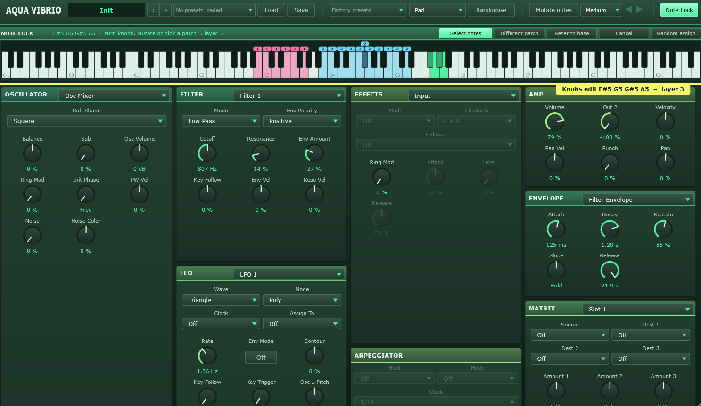

# Aqua Vibrio



A Virus-style virtual analog / wavetable polysynth in JUCE. Not a 1:1 emulation —
the aim is the same possibility space and the same character, with every control
on one scrollable panel and every knob doing exactly what its label says.

The sound engine is built from the Aquanode Modular Synth modules, molded into the
shape of the Virus's signal flow.

Almost every parameter in `Source/AquaVibrioParameters.h` is generated from the
hardware's own specification — 430+ program parameters with their ranges, defaults,
bipolarities and enumerated value names (the oscillator models, filter types,
saturation curves, filter bank modes, clock divisions, the modulation matrix
vocabulary, and so on).

## The voice

```
Osc 1 ─┐                            ┌─ Filter 1 ─ Saturation ─ Filter 2 ─┐
Osc 2 ─┤                            │     (serial, parallel or split)    │
Osc 3 ─┼─ mixer ─ Osc Volume ───────┤                                    ├─ Amp ─ Pan
Sub   ─┤  (ring mod, noise, input)  └────────────────────────────────────┘
Noise ─┘
```

Three oscillator models — Classic, HyperSaw and Wavetable — per oscillator, with
hard sync, pitch preserving sync, FM in seven modes, a sub oscillator, noise with
a sweepable colour filter, and ring modulation. Sixteen voices, with Poly, four
Mono modes (multi trigger, legato, and portamento only when you play legato) and
Hold, plus a sustain pedal and portamento that works in poly too.

Two filters with digital and ladder modes, serial / parallel / split routing, and
fifteen saturation curves between them driven by the Osc Volume knob.

Four envelopes, three LFOs and a six slot modulation matrix (three destinations
per slot), plus LFO 1 and 2's own Assign routes.

## The effects rack

In signal order: Input, Distortion, Filter Bank (ring modulator, frequency
shifter, vowel, comb, and crossfading / variable slope filters), Vocoder,
Character, EQ, Phaser, Chorus, Delay and Reverb as true sends, and a Granulator.

The Granulator is the Aquanode Modular's granulation effect in place of the
hardware's Atomizer: a rolling buffer of whatever played, resprayed as a
cloud of windowed grains, with Freeze to hold the buffer and scan it.

## The panel

Every knob reads in the units the engine actually uses — "807 Hz", "72.6 ms",
"+6.3 ct", "152 bpm", "-8.0 dB" — computed from the same curves the sound engine
uses, so a knob can never say something the engine does not do. Typing a value
("2 s", "440 Hz", "1.5k") snaps to the nearest setting.

A control whose effect is off in the current mode or choice of parameters is dimmed.

## Presets

All parameters are recalled on startup and in presets, so the host saves and
restores the complete state automatically. Patches can also be saved to and
loaded from disk with the Save / Load buttons, and there are factory presets in
the picker in the top bar.

The Randomise button generates a usable patch of the chosen character (Bass, Acid,
Reese, Hoover, Psy Lead, Pad, Glass Pad, Bell, Pluck, Metallic, Riser, Formant,
Granular and more) rather than scattering values at random — each character is a
profile describing register, oscillator model, filter window, envelope shapes and
effect balance, and the generator randomises inside those windows. Super Random,
at the bottom of the list, randomizes every parameter in a hopefully audible way.

## Note Lock

Press **Note Lock** and a keyboard strip opens under the top bar, covering all
128 keys (C-1 to G9, middle C is C4). Click or drag across keys to select them;
from then on every knob, Randomise, the factory presets, Load and Mutate edit
only those notes, and they play the new settings live while every other key
keeps the base patch. The panel gets a frame in the selection's colour, the
knobs it has changed are ringed, and the global controls are locked.

Press **Select notes** to keep it: what you changed becomes a numbered layer,
the knobs go back to the whole patch, and you can pick the next keys. A layer
remembers only the knobs that were changed - everything else keeps following
the base patch, so turning the base cutoff later still moves a layer that only
changed its envelope. **Different patch** gives the selected notes another
patch altogether (a random character, a factory preset or a file); that layer
remembers every knob.

Numbers: a new layer takes the lowest number not in use. Keys it takes over
leave their old layer, and a layer left with no keys disappears, freeing its
number. Selecting keys that all belong to one layer starts from that layer's
sound, so it can be reworked; a mixed selection starts from the base patch.
Click a number above the keys to select its whole layer, alt-click a key (or
use **Reset to base**) to return it to the base patch.

**Random assign** with keys selected gives them one shared mutation and one
number. With nothing selected, every key gets a mutation and a number of its
own, each grown from the sound that key had.

Effects are per layer too: the voices of each layer are summed through that
layer's own effects rack, and layers whose effects match the base patch share
the base rack, so they sound exactly as they did. Racks are created only when a
layer asks for effects of its own (each holds a five-second delay line and the
granulator's buffer, about 5 MB at 48 kHz) and are handed back once their tails
have gone quiet. With 16 voices there are at most 18. The arpeggiator, key
mode, tempo and the audio input decide which notes play, or happen once for the
whole instrument, so they always follow the base patch.

Layers are saved with the DAW session (in the plugin's state tree) and in
preset files (a `noteLayers` section, preset version 2). A preset without
layers loads exactly as before; Randomise and the factory presets with nothing
selected start a fresh patch without layers.

## Mutate

**Mutate** nudges the feel of the patch - or of the selected notes - without
changing what it is: brightness, snap, movement, width, grit and space move
together along a random direction, plus a little independent jitter per knob.
Pitch (semitones, key follow, transpose, bend, portamento) and structure
(oscillator models, filter modes and routing, matrix routings, effect types,
key mode, arp) never move, knobs that do nothing in the current mode are left
alone, and an effect whose send or mix is at zero stays off. Gentle, Medium and
Wild set how far it goes; the arrows step back and forth through the
generations, so you are the selection pressure.

## Notes

Some elements are approximations rather than close implementations — the
wavetables are the Aquanode table rather than the hardware's, and the built-in
arpeggiator patterns are generated rather than the original's.

Made with Claude Opus 5 as a free and open source option to an Access Virus-style
synthesizer. Thanks for trying it out!